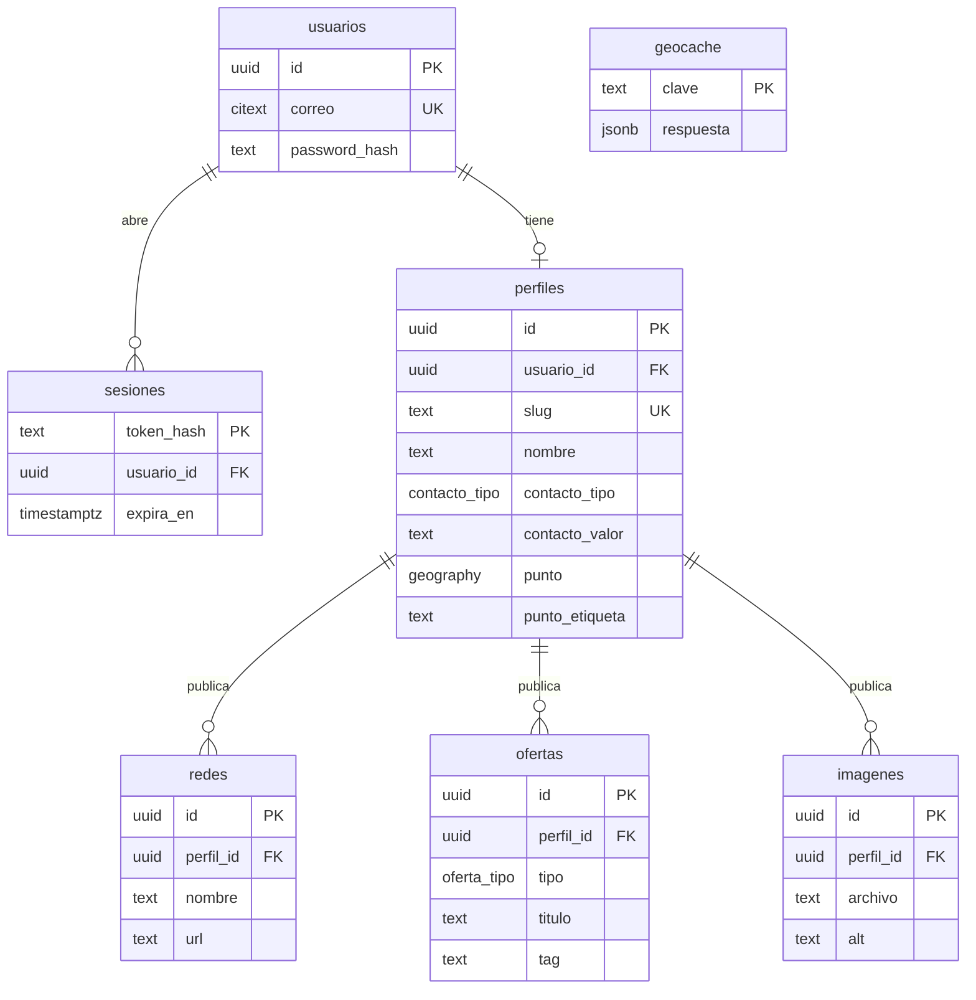

# [06] Modelo de datos — trabajamos.com

> Fuente de verdad del esquema. La migración ejecutable es `iterations/v1/migrations/001_inicial.sql` y debe coincidir con este documento.  
> Contrato de vistas: `04-html-design.md` §6. Módulos: `03-module-discovery.md`.

## 1. Extensiones

| Extensión | Para qué |
| :--- | :--- |
| `postgis` | Tipo `geography(Point, 4326)`, distancia en metros y búsqueda por cercanía con índice GIST |
| `citext` | Correo sin distinguir mayúsculas |
| `pgcrypto` | `gen_random_uuid()` |

## 2. Diagrama



## 3. Tipos

| Tipo | Valores | Contrato `04` |
| :--- | :--- | :--- |
| `contacto_tipo` | `telefono`, `correo`, `url` | `contacto.tipo` |
| `oferta_tipo` | `proyecto`, `servicio`, `oficio` | `Oferta.tipo` |

## 4. Tablas

### `usuarios` (`MOD-06`)

| Columna | Tipo | Regla |
| :--- | :--- | :--- |
| `id` | `uuid` PK | `gen_random_uuid()` |
| `correo` | `citext` | `NOT NULL UNIQUE`, check de formato básico |
| `password_hash` | `text` | `NOT NULL`. argon2id (`$argon2id$…`). Nunca se guarda la contraseña. |
| `intentos_fallidos` | `integer` | `NOT NULL DEFAULT 0` |
| `bloqueado_hasta` | `timestamptz` | `NULL`. Tras 5 intentos fallidos se bloquea 15 minutos. |
| `creado_en` | `timestamptz` | `NOT NULL DEFAULT now()` |
| `ultimo_acceso_en` | `timestamptz` | `NULL` |

### `sesiones` (`MOD-06`)

| Columna | Tipo | Regla |
| :--- | :--- | :--- |
| `token_hash` | `text` PK | SHA-256 del token de la cookie. La cookie lleva el token; la base solo el hash. |
| `usuario_id` | `uuid` | `NOT NULL` FK `usuarios(id) ON DELETE CASCADE` |
| `creado_en` | `timestamptz` | `NOT NULL DEFAULT now()` |
| `expira_en` | `timestamptz` | `NOT NULL`. 7 días desde el último uso. |

Índice: `sesiones(usuario_id)`.

### `perfiles` (`MOD-01`, `MOD-04`)

| Columna | Tipo | Regla |
| :--- | :--- | :--- |
| `id` | `uuid` PK | |
| `usuario_id` | `uuid` | `NOT NULL UNIQUE` FK `usuarios(id) ON DELETE CASCADE`. Un perfil por cuenta. |
| `slug` | `text` | `NOT NULL UNIQUE`, `^[a-z0-9]+(-[a-z0-9]+)*$`. Se genera al crear y no cambia. |
| `nombre` | `text` | `NOT NULL`, 1 a 120 caracteres sin espacios sobrantes |
| `contacto_tipo` | `contacto_tipo` | `NOT NULL` (D-01) |
| `contacto_valor` | `text` | `NOT NULL`, no vacío (D-01) |
| `punto` | `geography(Point, 4326)` | `NULL` = sin localidad confirmada |
| `punto_etiqueta` | `text` | `NULL`. Check: `(punto IS NULL) = (punto_etiqueta IS NULL)` (D-08) |
| `creado_en`, `actualizado_en` | `timestamptz` | `NOT NULL DEFAULT now()` |

Índice: GIST en `punto`.

### `redes` (`MOD-01`)

| Columna | Tipo | Regla |
| :--- | :--- | :--- |
| `id` | `uuid` PK | (D-09) |
| `perfil_id` | `uuid` | `NOT NULL` FK `perfiles(id) ON DELETE CASCADE` |
| `nombre` | `text` | `NOT NULL`, 1 a 60 caracteres |
| `url` | `text` | `NOT NULL`, empieza con `https://` |
| `orden` | `integer` | `NOT NULL` |
| `creado_en` | `timestamptz` | `NOT NULL DEFAULT now()` |

Índice: `redes(perfil_id, orden)`.

### `ofertas` (`MOD-02`)

| Columna | Tipo | Regla |
| :--- | :--- | :--- |
| `id` | `uuid` PK | (D-09) |
| `perfil_id` | `uuid` | `NOT NULL` FK `perfiles(id) ON DELETE CASCADE` |
| `tipo` | `oferta_tipo` | `NOT NULL` |
| `titulo` | `text` | `NOT NULL`, 1 a 120 caracteres (D-07) |
| `tag` | `text` | `NOT NULL`. Check: empieza con un solo `#`, sin espacios al borde ni dobles, en minúsculas (`tag = lower(tag)`). La aplicación normaliza con la regla única de `04` §3.3. |
| `creado_en` | `timestamptz` | `NOT NULL DEFAULT now()` |

Índices: `ofertas(tag)`, `ofertas(perfil_id, creado_en)`.

### `imagenes` (`MOD-03`)

| Columna | Tipo | Regla |
| :--- | :--- | :--- |
| `id` | `uuid` PK | (D-09) |
| `perfil_id` | `uuid` | `NOT NULL` FK `perfiles(id) ON DELETE CASCADE` |
| `archivo` | `text` | `NOT NULL UNIQUE`. Ruta relativa dentro de `UPLOADS_DIR`: `{perfil_id}/{id}.webp` |
| `alt` | `text` | `NOT NULL`, 1 a 300 caracteres |
| `ancho`, `alto` | `integer` | `NOT NULL` |
| `bytes` | `integer` | `NOT NULL` |
| `creado_en` | `timestamptz` | `NOT NULL DEFAULT now()` |

Índice: `imagenes(perfil_id, creado_en)`.

### `geocache` (`MOD-04`)

| Columna | Tipo | Regla |
| :--- | :--- | :--- |
| `clave` | `text` PK | `directa:{texto en minúsculas}` o `inversa:{lat con 4 decimales},{lng con 4 decimales}` |
| `respuesta` | `jsonb` | `NOT NULL`. Lista de `{ lat, lng, etiqueta }` o `{ etiqueta }` |
| `creado_en` | `timestamptz` | `NOT NULL DEFAULT now()`. Vigencia: 30 días. |

### `schema_migrations`

| Columna | Tipo | Regla |
| :--- | :--- | :--- |
| `version` | `text` PK | Nombre del archivo de migración |
| `aplicada_en` | `timestamptz` | `NOT NULL DEFAULT now()` |

## 5. Consultas clave

**Búsqueda de cercanos (`MOD-05`, `VIEW-04`).** Usa el índice GIST con el operador `<->` y devuelve la distancia en km:

```sql
SELECT o.id, o.tipo, o.titulo, o.tag, p.slug, p.nombre,
       ST_Distance(p.punto, ST_MakePoint($lng, $lat)::geography) / 1000.0 AS distancia_km
FROM ofertas o
JOIN perfiles p ON p.id = o.perfil_id
WHERE o.tag = $tag AND p.punto IS NOT NULL
ORDER BY p.punto <-> ST_MakePoint($lng, $lat)::geography, p.nombre
LIMIT 100;
```

**Distinguir los dos vacíos (D-04).** Si la consulta no trae filas, `SELECT EXISTS (SELECT 1 FROM ofertas WHERE tag = $tag)` separa "No encontramos #xyz" de "Ninguna oferta de #xyz tiene localidad marcada".

## 6. Reglas de integridad que vive en la aplicación

- Normalización del `#` (`04` §3.3). La base valida la forma, no las tildes.
- Teléfono en formato internacional (`+` y 8 a 15 dígitos), correo con formato válido y enlaces `https://` completos.
- Archivo de imagen real (lo abre `sharp`), máximo 5 MB.
- Bloqueo tras intentos fallidos y token CSRF.

## 7. Al salir del servidor de prueba

| Tema | En QA | En producción |
| :--- | :--- | :--- |
| Base de datos | Contenedor `postgis/postgis` con volumen local | PostgreSQL gestionado con PostGIS, respaldos automáticos y recuperación a un punto en el tiempo. El esquema se migra tal cual con `npm run migrate`. |
| Respaldos | `scripts/backup.sh` (`pg_dump` + carpeta de imágenes) | Respaldo gestionado y copia fuera del servidor |
| Imágenes | Carpeta `UPLOADS_DIR` en el disco | Almacenamiento de objetos compatible con S3 y CDN. `imagenes.archivo` pasa a ser la clave del objeto; la tabla no cambia. |
| Geocodificación | Nominatim público (1 consulta por segundo) | Nominatim propio o un proveedor de pago. Solo cambia el adaptador (`GEOCODER`). |
| Teselas del mapa | OpenStreetMap público | Proveedor de teselas con acuerdo de uso |
| Autenticación | Correo y contraseña, sin correo saliente | Agregar verificación de correo y recuperación de contraseña por correo (nueva tabla `tokens_correo`) |
| Secretos | `.env` en el servidor | Gestor de secretos y rotación de `SESSION_SECRET` |
| Sesiones vencidas | Se borran al iniciar sesión | Tarea periódica de limpieza |
